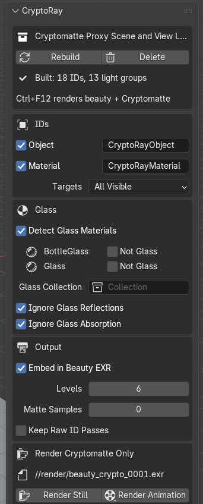
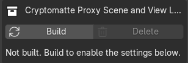
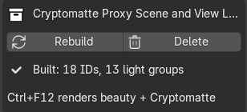
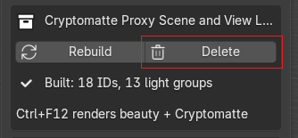
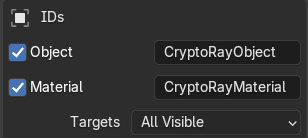
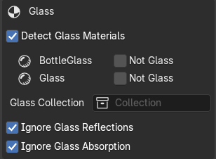
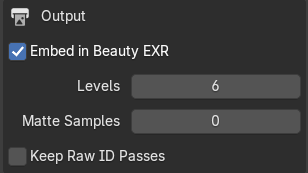
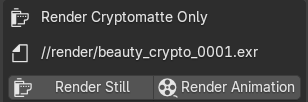

# CryptoRay for Blender

**English** · [简体中文](README.zh-CN.md) · [繁體中文](README.zh-TW.md)

Cryptomatte ID mattes for objects **seen through refractive glass**, distorted exactly like the beauty
render. Works with Cycles in Blender 4.2 and later, and writes standard Cryptomatte layers that Nuke's
Cryptomatte node (or any Cryptomatte reader) picks from directly.

| Beauty | Blender's Cryptomatte | CryptoRay |
|---|---|---|
|  |  |  |
| A red cube sits behind a glass ball. | The whole ball is one ID: "glass". Nothing behind it can be picked. | Every object behind the glass keeps its own ID, refracted like the beauty. |

Picking the red cube (`Cube_L`), shown in orange:

| Blender's Cryptomatte | CryptoRay |
|---|---|
|  |  |
| Empty: the cube is fully behind the glass. | The cube as seen through the ball. |

## Install

1. Download `cryptoray-<version>.zip` from [Releases](https://github.com/adamykchan/cryptoRay_blender/releases).
2. In Blender: **Edit › Preferences › Add-ons › ⌄ › Install from Disk…**, pick the zip, and tick **CryptoRay**.
3. In the 3D Viewport press **N** and open the **CryptoRay** tab.

## Quick start

### 1. Build

Click **Build**.

This adds a **proxy scene**: an extra view layer called `ID_MATTES` and a collection of proxy objects.
CryptoRay needs it to render the mattes. Your own objects, materials and beauty render are not changed.

If you add objects or change settings later, the panel says *Out of date*: click **Rebuild**.

### 2. Render the animation as usual

The output format must be **OpenEXR Multilayer** (*Multi-Layer EXR* in Blender 5) with the **ZIP** or
**PIZ** codec.

Press **Ctrl+F12** (*Render › Render Animation*), or render from the command line.

Each frame's EXR now contains the Cryptomatte layers `CryptoRayObject` (and `CryptoRayMaterial` if
ticked). In Nuke, read the EXR, add a **Cryptomatte** node, choose the layer and pick objects, including
the ones behind glass.

**F12** (Render Image) only shows the render and doesn't save it, so it doesn't produce a Cryptomatte.

### 3. Delete

When you're done, click **Delete**. It removes everything CryptoRay added. Rendered files are kept.

## Settings

### IDs

* **Object:** write a Cryptomatte layer with one ID per object, named like Blender's own CryptoObject.
* **Material:** write a layer with one ID per material, named like Blender's CryptoMaterial.
* The text field next to each is the **layer name** you'll see in Nuke. Default `CryptoRayObject` and
  `CryptoRayMaterial`.
* **Targets:**
  * *All Visible:* every visible object gets an ID (except glass).
  * *Collection:* only objects in the chosen collection get IDs. Other objects still hide what's behind
    them. Use this to cut down the number of light groups in big scenes.

### Glass

* **Detect Glass Materials:** finds glass by its material. Any material that refracts (Glass BSDF,
  Refraction BSDF, or Principled BSDF with Transmission) is listed here. Glass keeps its real shader so it
  bends the mattes, and gets no ID itself. An object with both glass and other materials (a bottle with a
  paper label) is split: the label gets an ID, the glass refracts.
* **Not Glass:** tick it to treat that material as a normal surface instead of glass. It gets its own ID in
  the Cryptomatte, and the mattes no longer show what's behind it.
* **Glass Collection:** optional. Whole objects in this collection are treated as glass.
* **Ignore Glass Reflections** (on by default): reflections on glass don't carry IDs, so whatever is behind
  the glass gets a solid matte. Turn it off and reflected objects show up in the glass too, mixed into the
  matte.

<table>
<tr><th>Render</th><th>On (default)</th><th>Off</th></tr>
<tr><td></td>
<td></td>
<td></td></tr>
</table>

* **Render:** The beauty: the floor and cubes reflect in the ball.
* **On (default):** Only what's behind the glass.
* **Off:** Reflections carry IDs too: the floor (yellow) fills the top of the ball, and reflected objects mix into what's behind it.

*Ignore Glass Reflections: frame 2 of the example scene, each colour one ID.*

* **Ignore Glass Absorption** (on by default): tinted or absorbing glass doesn't weaken the matte. Turn it
  off and the matte is only as strong as the light that actually gets through the glass.

<table>
<tr><th>Render</th><th>On (default)</th><th>Off</th></tr>
<tr><td></td>
<td></td>
<td></td></tr>
</table>

* **Render:** The beauty: the red cube is half behind the blue-tinted ball.
* **On (default):** The cube has the same colour outside the glass and through it: full strength.
* **Off:** Through the glass the cube is dimmer: only as strong as the light that gets through.

*Ignore Glass Absorption: frame 1 with the glass tinted blue, each colour one ID, the red cube picked in
yellow.*

Per object, you can also add the custom property `matte_role`: `"glass"` (treat as glass), `"ignore"`
(leave it out completely) or `"other"` (hides what's behind it but gets no ID).

*Object Properties › Custom Properties: click New, name it `matte_role`, set its type to String and its
value to `glass`, `ignore` or `other`.*

### Output

* **Embed in Beauty EXR** (on by default): the Cryptomatte layers go into the beauty EXR. Off: they go to a
  separate `<render name>_crypto_<frame>.exr` next to it.
* **Levels:** how many IDs are stored per pixel (Cryptomatte depth). 6 is the usual value.
* **Matte Samples:** samples for the matte render only. 0 uses the scene's samples. Raise it if mattes
  behind very dark glass are noisy.
* **Keep Raw ID Passes:** also save the raw light-group passes and a JSON manifest. Each pass can be used
  directly as a matte.

### Render Cryptomatte Only

Renders only the mattes, without the beauty, and writes `<render name>_crypto_<frame>.exr` to the path
shown. Use it when only the mattes need re-rendering, or when your beauty output isn't a Multilayer EXR.
**Render Still** does the current frame, **Render Animation** the frame range. It asks whether to rebuild
the proxy scene first (yes by default). Your render settings are put back afterwards.

## How it works

**The problem.** Cycles writes Cryptomatte IDs only where a camera ray first hits a surface. Behind
glass, that surface is the glass, so every pixel there gets the glass's ID (see the comparison at the
top). Shader AOVs have the same limit, and an add-on can't change Cycles itself.

**IDs as light.** IDs can't travel through glass, but light can. So CryptoRay renders a second time, in
its own view layer, where every object glows pure white and the glass keeps its real material. Each
object is put in its own Cycles **light group**, and Cycles saves every light group as a separate image.
That image is the object's matte, already refracted by the glass, blurred by rough glass and depth of
field, and anti-aliased exactly like the beauty.

**Leaving your scene alone.** Changing your materials to white would change your beauty render. Instead,
the `ID_MATTES` view layer hides all of your collections and shows its own copies: one proxy per object,
made with a Geometry Nodes *Object Info* node, so it follows the original's animation, deformation and
modifiers automatically. Proxies get a white glowing material; glass proxies keep the original glass.
That is the proxy scene that **Build** adds and **Delete** removes. The beauty render is identical with
or without it (checked pixel by pixel), and both layers render in the same Ctrl+F12.

**Particles are handled differently.** Object Info can't read legacy particle systems, so for each one
CryptoRay adds a copy of the emitter with the same seed and settings, which gives exactly the same
particles. Instead of the original objects, the copy's particles instance white-glowing duplicates of
them, so each particle gets the ID of the object it instances (as in Blender's own Cryptomatte). Hair
rendered as strands gets the white material on the copy, and its ID comes from the emitter's strand
material. Emitter particles are re-simulated in the copy, so bake them if the mattes drift.

**From light to coverage.** After each frame, CryptoRay reads the light groups and, for every pixel,
divides each one by the total of all of them. That gives each object's share of the pixel. The world is
an ID too (`Background`), so the shares always add up to 1. Dividing by the total also cancels out glass
tint and absorption (**Ignore Glass Absorption**). Reflection rays don't see the glowing proxies
(**Ignore Glass Reflections**), so reflections can't leak other IDs in. Where the camera sees almost only
reflection, such as total internal reflection at a bottle's edge, there's nothing behind the glass to
show, and the matte fades out softly.

**Writing the Cryptomatte.** For every pixel, the strongest IDs (6 by default) are stored with their
coverage, the names are hashed as the [Cryptomatte specification](https://github.com/Psyop/Cryptomatte)
requires, and the result is written into the EXR as standard Cryptomatte layers with a manifest. Then the
raw light groups are removed from the file.

**Objects and materials together.** Each object/material pair gets one light group. An object's matte is
the sum of its pairs, and a material's matte is the sum of its pairs across all objects, so both layers
come from one render.

## Limitations

* **Volumes** are not supported and are left out of the mattes.
* **Particles** are named after the instanced object, as in Blender's own Cryptomatte. Hair particles are
  tested; emitter particles are re-simulated in the proxy, so bake them if the mattes drift.
* Collection instances and Geometry Nodes instances get the **instancer's** name (Blender's own
  Cryptomatte names each instanced object).
* Each light group is a full-resolution image in GPU memory. Above 64 the panel warns; use the
  *Collection* target to reduce them.
* Objects placed directly in the *Scene Collection* (not inside any collection) can't be hidden from the
  ID layer, so Build stops and offers **Move Root Objects**, which puts them in a new collection. Your
  render doesn't change.
* Blender's own Cryptomatte manifest lists the wrong hash for about 1 in 128 names (its pixels are right).
  CryptoRay follows the specification, so picking works for every name.

## Example scene

[`examples/cryptoray_test_scene.blend`](examples/cryptoray_test_scene.blend) has cubes behind a glass
ball, a tinted bottle with a label, and instancing and particle cases, over 7 frames (in each frame one
element is fully behind the ball). Blender's own Cryptomatte is on too, for comparison. Save it somewhere
before rendering (the output path is relative to the .blend).
[`examples/make_test_scene.py`](examples/make_test_scene.py) builds the same scene from scratch:
`blender --python examples/make_test_scene.py`.

## License

Copyright © 2026 adamykchan. Licensed under [GPL-3.0-or-later](LICENSE).
