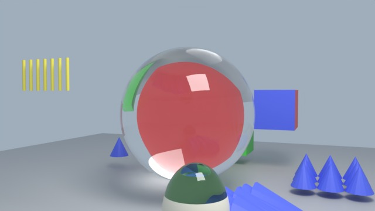
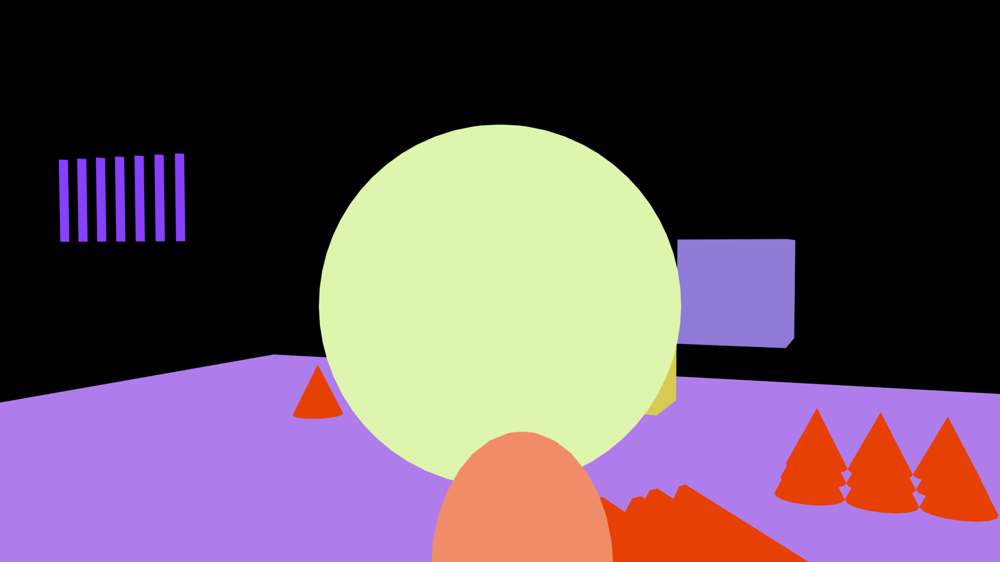
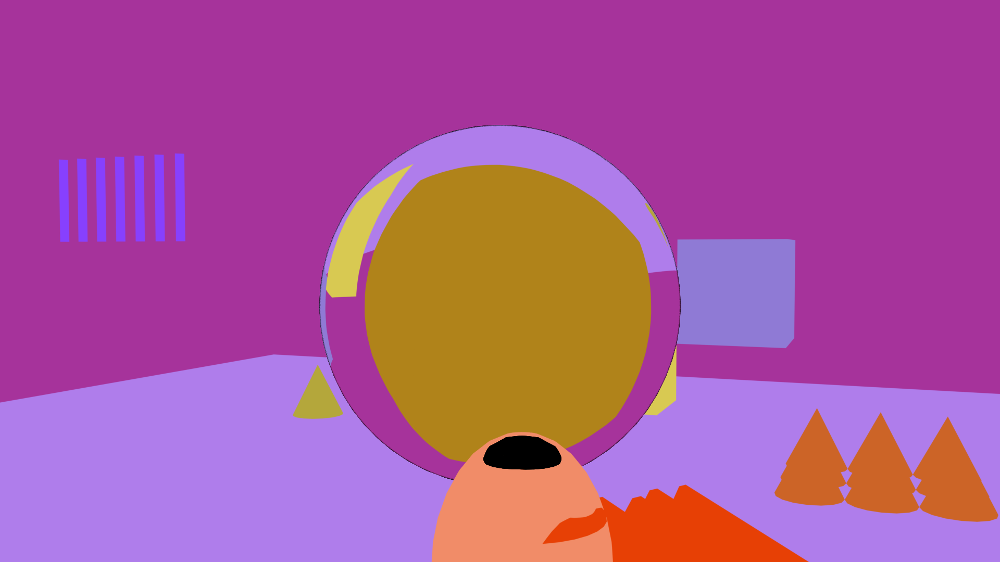
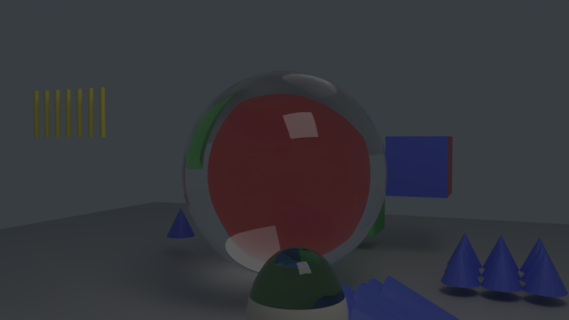
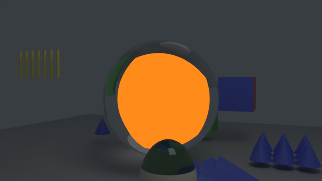
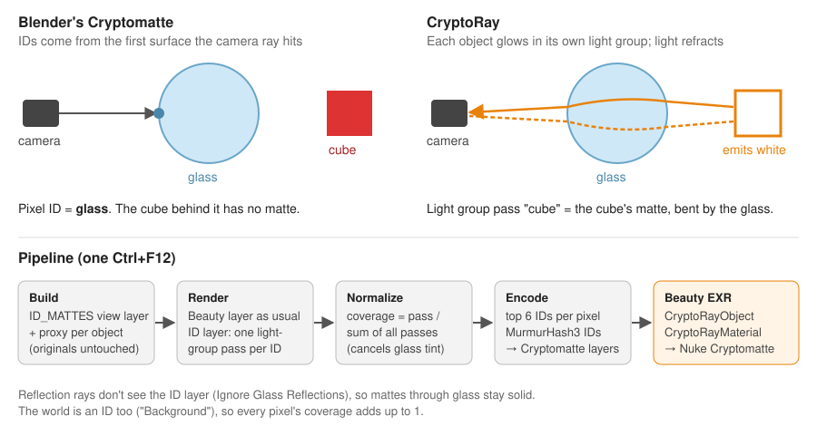

# CryptoRay for Blender

**English** · [简体中文](README.zh-CN.md) · [繁體中文](README.zh-TW.md)

Cryptomatte ID mattes for objects **seen through refractive glass**, distorted exactly like the beauty
render. Works with Cycles in Blender 4.2 and later, and writes standard Cryptomatte layers that Nuke's
Cryptomatte node (or any Cryptomatte reader) picks from directly.

| Beauty | Blender's Cryptomatte | CryptoRay |
|---|---|---|
|  |  |  |
| A red cube sits behind a glass ball. | The whole ball is one ID: "glass". Nothing behind it can be picked. | Every object behind the glass keeps its own ID, refracted like the beauty. |

Picking the red cube (`Cube_L`), shown in orange:

| Blender's Cryptomatte | CryptoRay |
|---|---|
|  |  |
| Empty: the cube is fully behind the glass. | The cube as seen through the ball. |

---

## Install

1. Download `cryptoray-<version>.zip` from [Releases](https://github.com/adamykchan/cryptoRay_blender/releases)
   (or zip the `cryptoray` folder of this repository yourself).
2. In Blender: **Edit › Preferences › Add-ons › ⌄ › Install from Disk…**, pick the zip, and tick **CryptoRay**.
3. In the 3D Viewport press **N** and open the **CryptoRay** tab.

Nothing else is needed: the EXR work uses the NumPy and OpenImageIO that ship with Blender, so it runs on
Windows, macOS and Linux.

## Quick start

Try it on the example scene first: open [`examples/cryptoray_test_scene.blend`](examples/cryptoray_test_scene.blend)
and save it somewhere (the render path is relative to the .blend).

**1. Build.** In *Cryptomatte Proxy Scene and View Layer*, click **Build**. The panel shows how many IDs
and light groups were made. The rest of the panel stays greyed out until you build. If you later add
objects or change settings, the panel says *Out of date*: click **Rebuild**.

**2. Choose IDs.** Tick **Object** and/or **Material**. The text field next to each is the Cryptomatte
layer name you will see in Nuke (`CryptoRayObject`, `CryptoRayMaterial`). Leave **Targets** on
*All Visible*, or pick *Collection* to give IDs only to one collection.

**3. Check the glass.** Glass is found automatically: any material that refracts (Glass BSDF,
Refraction BSDF, or Principled BSDF with Transmission) is listed under **Detect Glass Materials**. Those
materials stay real glass and get no ID. Tick **Not Glass** if one of them should get an ID anyway.
Objects that mix glass and other materials (a bottle with a paper label) are split, so the label gets an
ID and the glass still refracts.

**4. Set the output.** Render Properties › Output: **OpenEXR Multilayer**, codec **ZIP** or **PIZ**
(lossy codecs damage the IDs).

**5. Render.** Press **Ctrl+F12** (or render from the command line, `blender -b file.blend -a`). After each
frame the Cryptomatte layers are written into the beauty EXR. Your beauty image is the same as without
CryptoRay.

 

**Only need the mattes?** Under **Render Cryptomatte Only**, click **Render Still** or **Render Animation**.
This renders just the ID layer and writes `<render name>_crypto_<frame>.exr` next to your render (the path
for the current frame is shown above the buttons). The beauty is not rendered, and your render settings are
put back afterwards.

> A plain **F12** shows the render but doesn't save it to disk, so no Cryptomatte file is written. Use
> Ctrl+F12, the command line, or *Render Cryptomatte Only*.

**Done with it?** **Delete** removes everything CryptoRay added. Rendered files are kept.

## In Nuke

1. Read the beauty EXR.
2. Add a **Cryptomatte** node and set its layer to **CryptoRayObject** (or **CryptoRayMaterial**).
3. Pick objects with the eyedropper, or type names into the matte list. Objects behind glass can be
   picked through the glass.

No conversion step is needed: the EXR already holds standard Cryptomatte layers with a manifest.
Blender's own Cryptomatte layers (if turned on) stay in the file next to CryptoRay's.

## Options

| Option | Default | What it does |
|---|---|---|
| **Object / Material** | Object | Which Cryptomatte layers to write. Both come from the same render. |
| **Targets** | All Visible | *Collection*: only objects in that collection get IDs. Other objects still hide what's behind them. |
| **Detect Glass Materials** | on | Refracting materials stay glass. Off: only the Glass Collection and `matte_role` decide what is glass. |
| **Not Glass** (per material) | off | Give a detected glass material an ID anyway. |
| **Glass Collection** | — | Whole objects in this collection are treated as glass. |
| **Ignore Glass Reflections** | on | Reflections on glass carry no IDs, so objects behind glass get a solid matte. Off: reflected objects show up in the glass as partial coverage. |
| **Ignore Glass Absorption** | on | Mattes through tinted or absorbing glass stay at full strength. Off: the matte is as dark as the light that actually gets through. |
| **Embed in Beauty EXR** | on | Off: write a separate `<render name>_crypto_<frame>.exr` (with a colour-coded preview in RGBA). |
| **Levels** | 6 | IDs stored per pixel (Cryptomatte depth). |
| **Matte Samples** | 0 | Samples for the ID layer only. 0 uses the scene's samples. Raise it for very dark glass. |
| **Keep Raw ID Passes** | off | Also save the raw light-group passes and a JSON manifest. Each pass can be used directly as a matte. |

Per-object control: the custom property `matte_role` on an object can be `"glass"` (treat as glass),
`"ignore"` (leave out of the ID layer entirely) or `"other"` (blocks what's behind it but gets no ID).

## How it works

**Why Blender's Cryptomatte can't do this.** Cycles writes Cryptomatte IDs only where the camera ray
first hits a surface. Behind glass, that surface is the glass, so every pixel there gets the glass's ID.
Shader AOVs have the same limit, and an add-on can't change the Cycles kernel.

**Carrying IDs as light.** Light, unlike IDs, does travel through glass. CryptoRay adds a second view
layer, `ID_MATTES`, where every target object glows pure white and sits in its own Cycles **light group**,
while the glass keeps its real shader. Light groups split the render into one pass per group, so each
pass is exactly one object's matte, already bent by the glass, blurred by rough glass and defocus, and
anti-aliased like the beauty.

**Not touching your scene.** The ID layer doesn't change your materials. It excludes all your collections
and uses its own collection of *proxies*: one per object, built with a Geometry Nodes *Object Info* node
that reads the original live, so animation, deformation and modifiers follow automatically. The proxy
gets a white emission material; glass proxies keep the original glass. Particle systems get a matching
copy with the same seed. Everything added is tagged, so **Delete** removes exactly that. The beauty
render is identical with or without CryptoRay (checked pixel by pixel).

**Turning light into coverage.** After each frame, CryptoRay reads the light-group passes and, for each
pixel, divides each pass by the sum of all of them. The world is an ID too (`Background`), so the
coverages always add up to 1, and glass tint or absorption cancels out. Reflection rays don't see the ID
layer, so reflections on the glass don't leak other IDs into the matte. Where the camera sees almost only
reflection (for example total internal reflection at the edge of a bottle) there is nothing behind the
glass to show, and the matte fades out with soft edges.

**Writing Cryptomatte.** The strongest IDs per pixel (6 by default) are hashed with MurmurHash3 as the
[Cryptomatte specification](https://github.com/Psyop/Cryptomatte) requires and written as standard
`CryptoRayObject00…` layers with a manifest, into the beauty EXR. Each ID keeps a real coverage value, not
a packed code, so soft edges stay correct.

**Object and material IDs together.** Each object/material pair gets one light group. An object's matte is
the sum of its pairs; a material's matte is the sum of its pairs across objects. So both layers come from
one render.

## Chinese interface

The panel, tooltips and messages are translated into Simplified and Traditional Chinese. In
**Edit › Preferences › Interface › Translation**, choose *简体中文* or *繁體中文* and tick **Interface** and
**Tooltips**.

## Limitations

* **Volumes** are not supported and are left out of the ID layer.
* **Particles** are named after the instanced object, as in Blender's own Cryptomatte. Hair particles
  are tested; simulated emitter particles are re-simulated in the copy, so bake them if the mattes drift.
* Collection instances and Geometry Nodes instances get the **instancer's** name (Blender's own
  Cryptomatte names each instanced object).
* Each light group is a full-resolution float buffer. Above 64 groups the panel warns; use the
  *Collection* target to reduce them.
* Objects linked directly to the *Scene Collection* can't be hidden from a view layer. The panel offers
  **Move Root Objects**, which puts them into a collection (the render is unchanged).
* Blender's own Cryptomatte manifest lists the wrong hash for about 1 in 128 names (its pixels are
  right). CryptoRay follows the specification, so picking works for every name.

## Example scene

[`examples/cryptoray_test_scene.blend`](examples/cryptoray_test_scene.blend) has cubes behind a glass
ball, a tinted bottle with a label, and instancing and particle cases, over 7 frames (in each frame one
element is fully behind the ball). Blender's own Cryptomatte is on too, for comparison.
[`examples/make_test_scene.py`](examples/make_test_scene.py) builds the same scene from scratch:
`blender --python examples/make_test_scene.py`.

## License

Copyright © 2026 adamykchan. Licensed under [GPL-3.0-or-later](LICENSE), like Blender.
