# CryptoRay for Blender

[English](README.md) · **简体中文** · [繁體中文](README.zh-TW.md)

为**透过折射玻璃看到的物体**生成 Cryptomatte ID 遮罩，折射变形与 Beauty 渲染完全一致。适用于 Blender 4.2 及以上版本的 Cycles，输出标准的 Cryptomatte 层，Nuke 的 Cryptomatte 节点（或任何 Cryptomatte 读取工具）可以直接拾取。

| Beauty | Blender 自带的 Cryptomatte | CryptoRay |
|---|---|---|
| 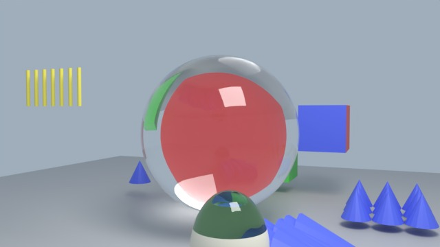 | 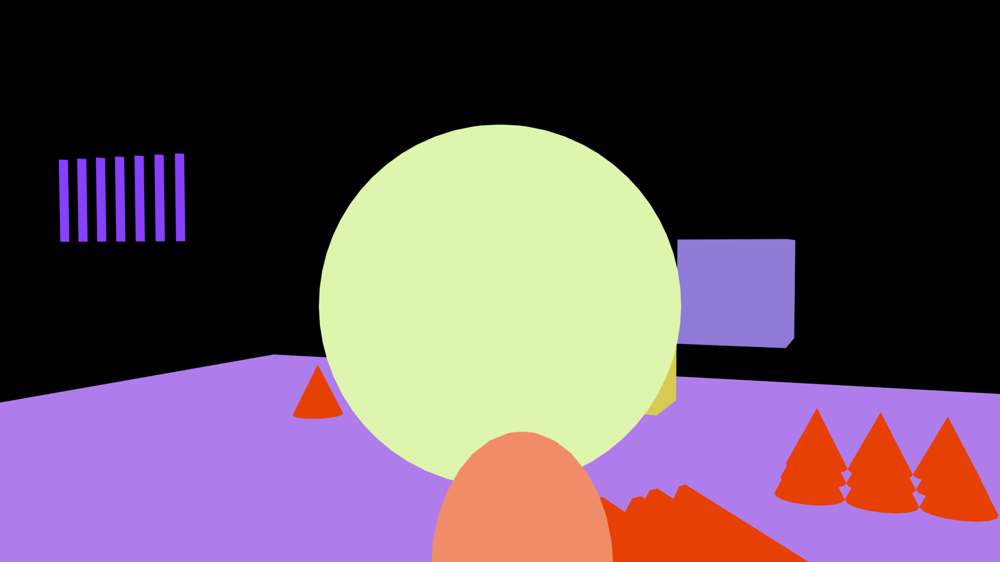 | 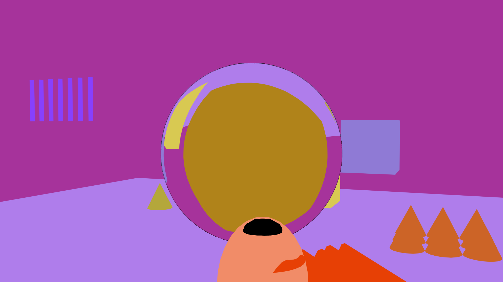 |
| 一个红色立方体在玻璃球后面。 | 整个球是同一个 ID：“glass”。后面的东西都拾取不到。 | 玻璃后面的每个物体都保留自己的 ID，折射效果与 Beauty 相同。 |

拾取红色立方体（`Cube_L`），以橙色显示：

| Blender 自带的 Cryptomatte | CryptoRay |
|---|---|
| 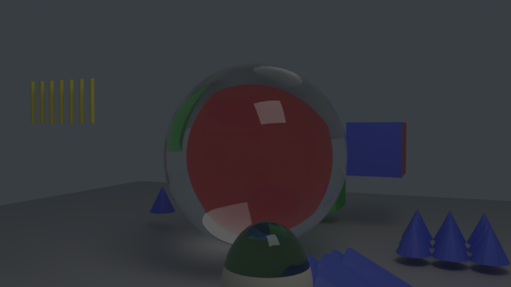 | 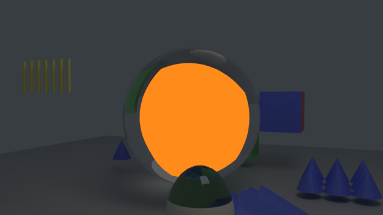 |
| 空的：立方体完全在玻璃后面。 | 透过玻璃球看到的立方体。 |

## 安装

1. 从 [Releases](https://github.com/adamykchan/cryptoRay_blender/releases) 下载 `cryptoray-<版本>.zip`。
2. 在 Blender 中：**编辑 › 偏好设置 › 插件 › ⌄ › 从磁盘安装…**，选择 zip，然后勾选 **CryptoRay**。
3. 在 3D 视图中按 **N**，打开 **CryptoRay** 标签页。

插件界面支持中文：在**编辑 › 偏好设置 › 界面 › 翻译**中选择*简体中文*，并勾选**界面**和**工具提示**。

## 快速上手

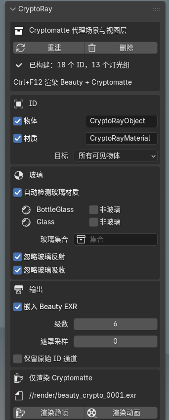

### 1. 构建

点击**构建**。

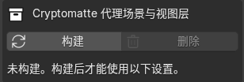

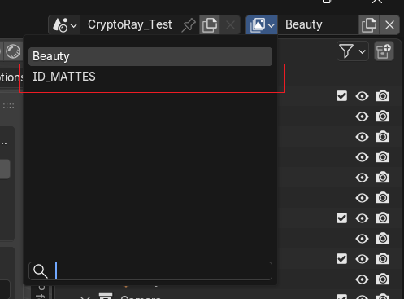

这会添加一个**代理场景**：一个名为 `ID_MATTES` 的额外视图层，以及一个代理物体集合。CryptoRay 需要它来渲染遮罩。你自己的物体、材质和 Beauty 渲染都不会被改动。

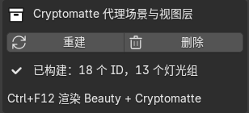

之后如果添加了物体或更改了设置，面板会显示“已过期”：点击**重建**即可。

### 2. 像平常一样渲染动画

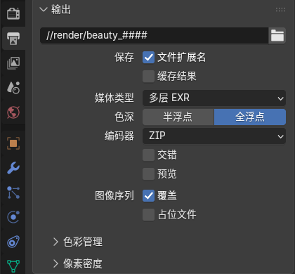

输出格式必须是 **OpenEXR 多层**（Blender 5 中：**媒体类型**设为**多层 EXR**），**编码器**为 **ZIP** 或 **PIZ**。

按 **Ctrl+F12**（*渲染 › 渲染动画*），或用命令行渲染。

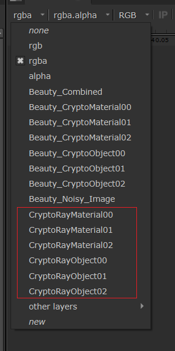

现在每一帧的 EXR 都包含 Cryptomatte 层 `CryptoRayObject`（勾选了材质时还有 `CryptoRayMaterial`）。在 Nuke 中读取 EXR，添加 **Cryptomatte** 节点，选择该层并拾取物体，包括玻璃后面的物体。

**F12**（渲染图像）只显示渲染结果，不保存到磁盘，所以不会生成 Cryptomatte。

### 3. 删除

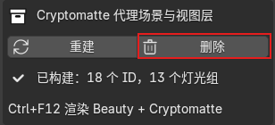

用完后点击**删除**。它会移除 CryptoRay 添加的所有内容。已渲染的文件会保留。

## 设置

### ID

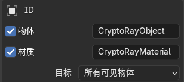

* **物体**：写出一个 Cryptomatte 层，每个物体一个 ID，命名方式与 Blender 自带的 CryptoObject 相同。
* **材质**：写出一个层，每个材质一个 ID，命名方式与 Blender 自带的 CryptoMaterial 相同。
* 旁边的文本框是你在 Nuke 中看到的**层名称**。默认为 `CryptoRayObject` 和 `CryptoRayMaterial`。
* **目标：**
  * *所有可见物体*：除玻璃外，每个可见物体都获得 ID。
  * *集合*：只有所选集合中的物体获得 ID。其他物体仍会遮挡后面的东西。大场景中可以用它减少灯光组数量。

### 玻璃

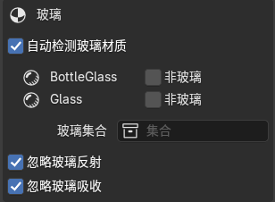

* **自动检测玻璃材质**：根据材质找出玻璃。任何会折射的材质（玻璃 BSDF、折射 BSDF，或带透射的原理化 BSDF）都会列在这里。玻璃保留真实的着色器，因此会弯曲遮罩，它自己不获得 ID。同时含有玻璃和其他材质的物体（例如贴了纸标签的瓶子）会被拆分：标签获得 ID，玻璃照样折射。
* **非玻璃**：勾选后，该材质被当作普通表面而不是玻璃。它会在 Cryptomatte 中获得自己的 ID，遮罩也不再显示它后面的东西。
* **玻璃集合**：可选。此集合中的整个物体都视为玻璃。
* **忽略玻璃反射**（默认开启）：玻璃上的反射不带 ID，所以玻璃后面的东西得到完整的遮罩。关闭后，被反射的物体也会出现在玻璃中，混进遮罩里。

<table>
<tr><th>渲染</th><th>开启（默认）</th><th>关闭</th></tr>
<tr><td>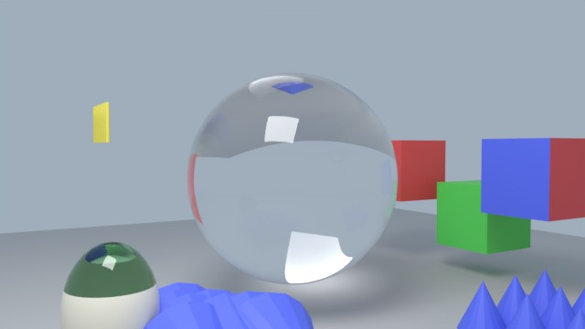</td>
<td>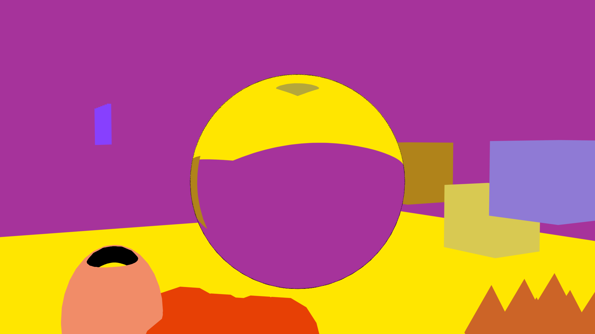</td>
<td>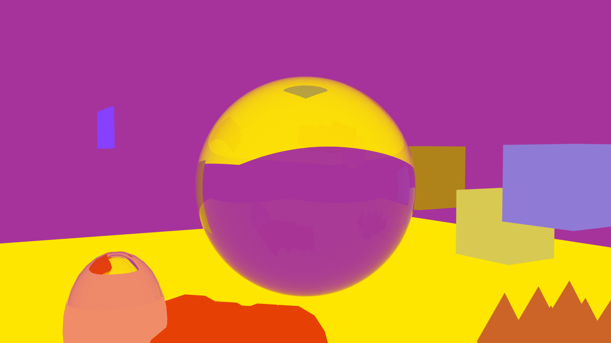</td></tr>
</table>

* **渲染**：Beauty：地面和立方体倒映在球上。
* **开启（默认）**：只有玻璃后面的东西。
* **关闭**：反射也带有 ID：地面（黄色）填满了球的上半部，被反射的物体混进玻璃后面的东西里。

*忽略玻璃反射：示例场景第 2 帧，每种颜色代表一个 ID。*

* **忽略玻璃吸收**（默认开启）：有色或吸光的玻璃不会削弱遮罩。关闭后，遮罩的强度只等于实际透过玻璃的光。

<table>
<tr><th>渲染</th><th>开启（默认）</th><th>关闭</th></tr>
<tr><td>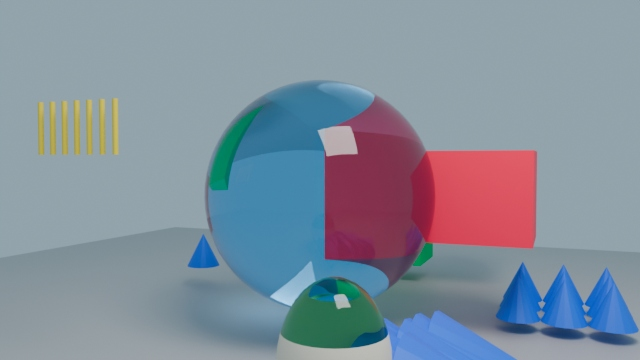</td>
<td>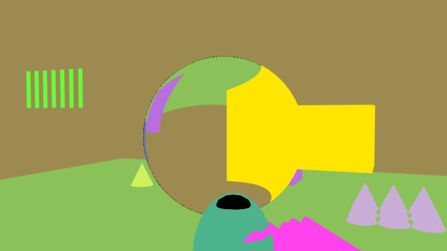</td>
<td>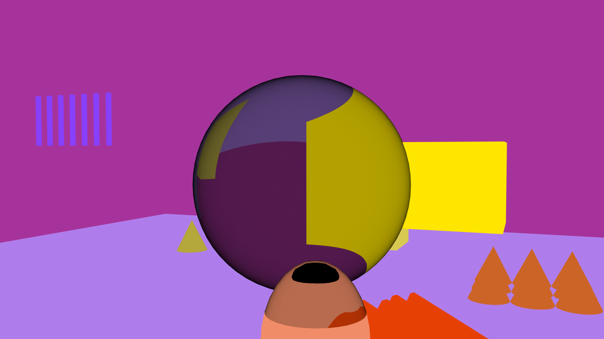</td></tr>
</table>

* **渲染**：Beauty：红色立方体一半在蓝色玻璃球后面。
* **开启（默认）**：立方体在玻璃外和透过玻璃的颜色相同：完整强度。
* **关闭**：透过玻璃的立方体更暗：强度只等于透过来的光。

*忽略玻璃吸收：第 1 帧，玻璃染成蓝色，每种颜色代表一个 ID，红色立方体以黄色显示为已拾取。*

也可以逐个物体添加自定义属性 `matte_role`：`"glass"`（视为玻璃）、`"ignore"`（完全排除）或 `"other"`（遮挡后面的东西，但自己没有 ID）。

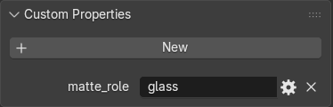

*物体属性 › 自定义属性：点击“新建”，命名为 `matte_role`，类型设为字符串，值为 `glass`、`ignore` 或 `other`。*

### 输出

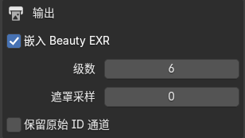

* **嵌入 Beauty EXR**（默认开启）：Cryptomatte 层写入 Beauty EXR。关闭：写到旁边单独的 `<渲染名>_crypto_<帧>.exr`。
* **级数**：每个像素存储的 ID 数量（Cryptomatte 深度）。通常为 6。
* **遮罩采样**：仅用于遮罩渲染的采样数。0 表示使用场景的采样数。玻璃很暗导致遮罩有噪点时可以调高。
* **保留原始 ID 通道**：另外保存原始灯光组通道和 JSON 清单。每个通道都可以直接当遮罩使用。

### 仅渲染 Cryptomatte

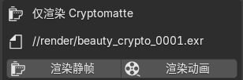

只渲染遮罩，不渲染 Beauty，并将 `<渲染名>_crypto_<帧>.exr` 写到显示的路径。适合只需要重新渲染遮罩，或者 Beauty 输出不是多层 EXR 的情况。**渲染静帧**渲染当前帧**，渲染动画**渲染帧范围。它会先询问是否重新构建代理场景（默认为是）。完成后渲染设置会恢复原样。

## 工作原理

**问题所在。** Cycles 只在摄像机光线第一次击中表面的地方写入 Cryptomatte ID。在玻璃后面，这个表面就是玻璃，所以那里的每个像素都是玻璃的 ID（见顶部的对比）。着色器 AOV 也有同样的限制，而插件无法修改 Cycles 本身。

**用光来传递 ID。** ID 无法穿过玻璃，但光可以。所以 CryptoRay 在自己的视图层中再渲染一次：每个物体都发出纯白光，玻璃保持真实材质。每个物体放在自己的 Cycles **灯光组**里，Cycles 会把每个灯光组单独保存为一张图像。这张图像就是该物体的遮罩：已经被玻璃折射，被粗糙玻璃和景深模糊，抗锯齿也与 Beauty 完全相同。

**不改动你的场景。** 把材质改成白色会改变 Beauty 渲染。所以 `ID_MATTES` 视图层隐藏你所有的集合，改为显示它自己的副本：每个物体一个代理，用几何节点的*物体信息*节点制作，因此会自动跟随原物体的动画、变形和修改器。代理使用白色发光材质；玻璃的代理保留原来的玻璃材质。这就是**构建**添加**、删除**移除的代理场景。无论有没有它，Beauty 渲染都完全相同（已逐像素验证），而且两个层在同一次 Ctrl+F12 中一起渲染。

**粒子的处理方式不同。** 物体信息节点无法读取旧式粒子系统，所以 CryptoRay 会为每个粒子系统添加一个发射体副本，种子和设置都相同，因此粒子完全一样。副本的粒子实例化的是发白光的物体副本，而不是原物体，所以每个粒子都获得它所实例化物体的 ID（与 Blender 自带的 Cryptomatte 相同）。以发丝渲染的毛发会在副本上使用白色材质，其 ID 来自发射体的发丝材质。发射体粒子会在副本中重新模拟，如果遮罩有偏差，请先烘焙。

**从光到覆盖率。** 每渲染完一帧，CryptoRay 读取各灯光组，在每个像素上把每个灯光组除以所有灯光组之和，得到每个物体在该像素中所占的比例。世界环境也是一个 ID（`Background`），所以比例总和始终为 1。除以总和也会抵消玻璃的染色和吸收（**忽略玻璃吸收**）。反射光线看不到发光的代理（**忽略玻璃反射**），所以反射不会把其他 ID 混进来。在摄像机几乎只看到反射的地方（例如瓶子边缘的全内反射），玻璃后面没有可显示的东西，遮罩会柔和地淡出。

**写出 Cryptomatte。** 每个像素中最强的几个 ID（默认 6 个）连同覆盖率一起保存，名称按照[Cryptomatte 规范](https://github.com/Psyop/Cryptomatte)的要求计算哈希，结果作为带清单的标准 Cryptomatte 层写入 EXR。之后原始灯光组会从文件中移除。

**物体与材质同时生成。** 每个“物体/材质”组合使用一个灯光组。物体的遮罩是它所有组合之和，材质的遮罩是所有物体中该材质的组合之和，因此两个层来自同一次渲染。

## 限制

* 不支持**体积**，体积不会进入遮罩。
* **粒子**以被实例化的物体命名，与 Blender 自带的 Cryptomatte 相同。毛发粒子已测试；发射体粒子会在代理中重新模拟，如果遮罩有偏差，请先烘焙。
* 集合实例和几何节点实例使用**实例化物体本身**的名称（Blender 自带的 Cryptomatte 使用每个被实例化物体的名称）。
* 每个灯光组都是显存中一张全分辨率图像。超过 64 个时面板会警告；可以用“集合”目标减少数量。
* 直接放在*场景集合*中（不在任何集合里）的物体无法从 ID 层中隐藏，所以构建会停止，并提供**移动根物体**，把它们放进一个新集合。你的渲染结果不变。
* Blender 自带的 Cryptomatte 清单中，大约每 128 个名称有 1 个哈希值有误（像素本身正确）。CryptoRay 遵循规范，因此每个名称都能拾取。

## 示例场景

[`examples/cryptoray_test_scene.blend`](examples/cryptoray_test_scene.blend) 包含玻璃球后面的立方体、贴有标签的有色瓶子，以及实例化和粒子的测试用例，共 7 帧（每一帧都有一个元素完全在玻璃球后面）。同时开启了 Blender 自带的 Cryptomatte 以便对比。渲染前请先另存到某个位置（输出路径是相对于 .blend 文件的）。[`examples/make_test_scene.py`](examples/make_test_scene.py) 可以从零生成同一个场景：`blender --python examples/make_test_scene.py`。

## 许可证

Copyright © 2026 adamykchan。以 [GPL-3.0-or-later](LICENSE) 授权。
