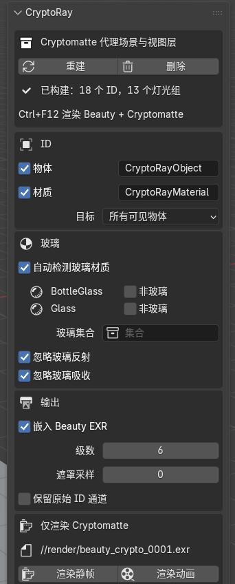
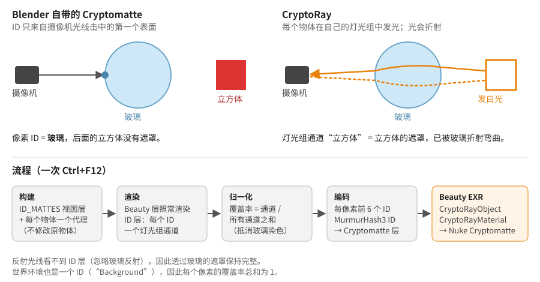

# CryptoRay for Blender

[English](README.md) · **简体中文** · [繁體中文](README.zh-TW.md)

为**透过折射玻璃看到的物体**生成 Cryptomatte ID 遮罩，折射变形与 Beauty 渲染完全一致。适用于
Blender 4.2 及以上版本的 Cycles，输出标准的 Cryptomatte 层，Nuke 的 Cryptomatte 节点（或任何
Cryptomatte 读取工具）可以直接拾取。

| Beauty | Blender 自带的 Cryptomatte | CryptoRay |
|---|---|---|
|  |  |  |
| 一个红色立方体在玻璃球后面。 | 整个球是同一个 ID：“玻璃”。后面的东西都拾取不到。 | 玻璃后面的每个物体都保留自己的 ID，折射效果与 Beauty 相同。 |

拾取红色立方体（`Cube_L`），以橙色显示：

| Blender 自带的 Cryptomatte | CryptoRay |
|---|---|
|  |  |
| 空的：立方体完全在玻璃后面。 | 透过玻璃球看到的立方体。 |

---

## 安装

1. 从 [Releases](https://github.com/adamykchan/cryptoRay_blender/releases) 下载 `cryptoray-<版本>.zip`
   （或自行把本仓库的 `cryptoray` 文件夹压缩成 zip）。
2. 在 Blender 中：**编辑 › 偏好设置 › 插件 › ⌄ › 从磁盘安装…**，选择 zip，然后勾选 **CryptoRay**。
3. 在 3D 视图中按 **N**，打开 **CryptoRay** 标签页。

不需要安装其他东西：EXR 处理使用 Blender 自带的 NumPy 和 OpenImageIO，因此可在 Windows、macOS 和
Linux 上运行。

## 快速上手

建议先用示例场景试一下：打开 [`examples/cryptoray_test_scene.blend`](examples/cryptoray_test_scene.blend)
并另存到某个位置（渲染路径是相对于 .blend 文件的）。

**1. 构建。** 在“Cryptomatte 代理场景与视图层”中点击**构建**。面板会显示生成了多少个 ID 和灯光组。
构建之前，面板其余部分是灰色的。之后如果添加了物体或更改了设置，面板会显示“已过期”：点击
**重建**即可。

**2. 选择 ID。** 勾选**物体**和/或**材质**。旁边的文本框是在 Nuke 中看到的 Cryptomatte 层名称
（`CryptoRayObject`、`CryptoRayMaterial`）。**目标**保持“所有可见物体”，或选择“集合”只为某个集合
生成 ID。

**3. 检查玻璃。** 玻璃会被自动检测：任何会折射的材质（玻璃 BSDF、折射 BSDF，或带透射的原理化
BSDF）都会列在**自动检测玻璃材质**下面。这些材质保持真实的玻璃效果，不分配 ID。如果其中某个需要
ID，勾选**非玻璃**。同时含有玻璃和其他材质的物体（例如贴了纸标签的瓶子）会被拆分，标签获得 ID，
玻璃照样折射。

**4. 设置输出。** 渲染属性 › 输出：**OpenEXR 多层**，编码 **ZIP** 或 **PIZ**（有损编码会破坏 ID）。

**5. 渲染。** 按 **Ctrl+F12**（或用命令行 `blender -b file.blend -a`）。每渲染完一帧，Cryptomatte 层
就会写入 Beauty EXR。Beauty 图像与不使用 CryptoRay 时完全一样。

 

**只需要遮罩？** 在**仅渲染 Cryptomatte** 下点击**渲染静帧**或**渲染动画**。这只渲染 ID 层，并在渲染
文件旁写入 `<渲染名>_crypto_<帧>.exr`（当前帧的路径显示在按钮上方）。不会渲染 Beauty，渲染设置
在完成后会恢复原样。

> 普通的 **F12** 只显示渲染结果，不保存到磁盘，所以不会写出 Cryptomatte 文件。请使用 Ctrl+F12、
> 命令行，或“仅渲染 Cryptomatte”。

**用完了？** 点击**删除**会移除 CryptoRay 添加的所有内容。已渲染的文件会保留。

## 在 Nuke 中使用

1. 用 Read 节点读取 Beauty EXR。
2. 添加 **Cryptomatte** 节点，层选择 **CryptoRayObject**（或 **CryptoRayMaterial**）。
3. 用吸管拾取物体，或在遮罩列表中输入名称。玻璃后面的物体可以隔着玻璃拾取。

不需要任何转换步骤：EXR 中已经是带清单（manifest）的标准 Cryptomatte 层。Blender 自带的
Cryptomatte 层（如果开启）也会和 CryptoRay 的层一起保留在文件里。

## 选项

| 选项 | 默认 | 作用 |
|---|---|---|
| **物体 / 材质** | 物体 | 要写出哪些 Cryptomatte 层。两者来自同一次渲染。 |
| **目标** | 所有可见物体 | “集合”：只有该集合中的物体获得 ID，其他物体仍会遮挡后面的东西。 |
| **自动检测玻璃材质** | 开 | 会折射的材质保持为玻璃。关闭：只由玻璃集合和 `matte_role` 决定哪些是玻璃。 |
| **非玻璃**（每个材质） | 关 | 仍给检测到的玻璃材质分配 ID。 |
| **玻璃集合** | — | 此集合中的整个物体都视为玻璃。 |
| **忽略玻璃反射** | 开 | 玻璃上的反射不带 ID，玻璃后的物体得到完整遮罩。关闭：被反射的物体会以部分覆盖率出现在玻璃中。 |
| **忽略玻璃吸收** | 开 | 透过有色或吸光玻璃的遮罩保持完整强度。关闭：遮罩的强度等于实际透过的光。 |
| **嵌入 Beauty EXR** | 开 | 关闭：另外写出 `<渲染名>_crypto_<帧>.exr`（RGBA 为彩色预览）。 |
| **级数** | 6 | 每个像素存储的 ID 数量（Cryptomatte 深度）。 |
| **遮罩采样** | 0 | 仅用于 ID 层的采样数。0 表示使用场景采样数。玻璃很暗时可以调高。 |
| **保留原始 ID 通道** | 关 | 另外保存原始灯光组通道和 JSON 清单。每个通道都可以直接当遮罩使用。 |

逐个物体控制：可以在物体上添加自定义属性 `matte_role`，值为 `"glass"`（视为玻璃）、`"ignore"`
（完全不进入 ID 层）或 `"other"`（会遮挡后面的物体，但自己没有 ID）。

## 工作原理

**为什么 Blender 自带的 Cryptomatte 做不到。** Cycles 只在摄像机光线第一次击中表面的地方写入
Cryptomatte ID。在玻璃后面，第一次击中的就是玻璃，所以那里的每个像素都是玻璃的 ID。着色器 AOV
也有同样的限制，而插件无法修改 Cycles 内核。

**用光来传递 ID。** ID 无法穿过玻璃，但光可以。CryptoRay 新增第二个视图层 `ID_MATTES`，其中每个
目标物体都发出纯白光，并各自放在一个 Cycles **灯光组**里，而玻璃保持真实的着色器。灯光组会把渲染
拆分成每组一个通道，所以每个通道正好就是一个物体的遮罩：已经被玻璃折射弯曲，被粗糙玻璃和景深
模糊，抗锯齿也与 Beauty 相同。

**不修改你的场景。** ID 层不会改动你的材质。它排除你所有的集合，使用自己的一组*代理*物体：每个物体
一个，用几何节点的“物体信息”节点实时读取原物体，因此动画、变形和修改器都会自动跟随。代理物体使用
白色自发光材质；玻璃的代理保留原来的玻璃材质。粒子系统会生成一个种子相同的副本。所有新增内容都
带有标记，因此**删除**只会移除这些内容。无论有没有 CryptoRay，Beauty 渲染都完全相同（已逐像素验证）。

**把光转换成覆盖率。** 每渲染完一帧，CryptoRay 读取灯光组通道，在每个像素上把每个通道除以所有通道
之和。世界环境也是一个 ID（`Background`），所以覆盖率总和始终为 1，玻璃的染色和吸收也会被抵消。
反射光线看不到 ID 层，所以玻璃上的反射不会把其他 ID 混进遮罩。在摄像机几乎只看到反射的地方（例如
瓶子边缘的全内反射），玻璃后面没有可显示的东西，遮罩会以柔和的边缘淡出。

**写出 Cryptomatte。** 每个像素中最强的几个 ID（默认 6 个）按照
[Cryptomatte 规范](https://github.com/Psyop/Cryptomatte)用 MurmurHash3 计算哈希，并作为带清单的标准
`CryptoRayObject00…` 层写入 Beauty EXR。每个 ID 保存真实的覆盖率数值，而不是压缩编码，因此柔和的
边缘也是正确的。

**物体 ID 与材质 ID 同时生成。** 每个“物体/材质”组合使用一个灯光组。物体的遮罩是它所有组合之和；
材质的遮罩是所有物体中使用该材质的组合之和。因此两个层来自同一次渲染。

## 中文界面

面板、工具提示和消息都已翻译成简体中文和繁体中文。在**编辑 › 偏好设置 › 界面 › 翻译**中选择
*简体中文*或*繁體中文*，并勾选**界面**和**工具提示**。

## 限制

* 不支持**体积**，体积物体不进入 ID 层。
* **粒子**以被实例化的物体命名，与 Blender 自带的 Cryptomatte 相同。毛发粒子已测试；发射器粒子会在
  副本中重新模拟，如果遮罩有偏差，请先烘焙。
* 集合实例和几何节点实例使用**实例化物体本身**的名称（Blender 自带的 Cryptomatte 会使用每个被实例化
  物体的名称）。
* 每个灯光组都是一个全分辨率浮点缓冲区。超过 64 个时面板会警告；可以用“集合”目标减少数量。
* 直接放在*场景集合*中的物体无法在视图层中排除。面板提供**移动根物体**，把它们放进一个集合
  （渲染结果不变）。
* Blender 自带的 Cryptomatte 清单中，大约每 128 个名称有 1 个哈希值有误（像素本身正确）。CryptoRay
  遵循规范，因此每个名称都能拾取。

## 示例场景

[`examples/cryptoray_test_scene.blend`](examples/cryptoray_test_scene.blend) 包含玻璃球后面的立方体、
贴有标签的有色瓶子，以及实例化和粒子的测试用例，共 7 帧（每一帧都有一个元素完全在玻璃球后面）。
同时开启了 Blender 自带的 Cryptomatte 以便对比。
[`examples/make_test_scene.py`](examples/make_test_scene.py) 可以从零生成同一个场景：
`blender --python examples/make_test_scene.py`。

## 许可证

Copyright © 2026 adamykchan。以 [GPL-3.0-or-later](LICENSE) 授权，与 Blender 相同。
