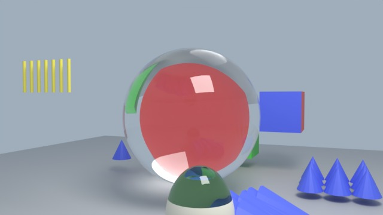
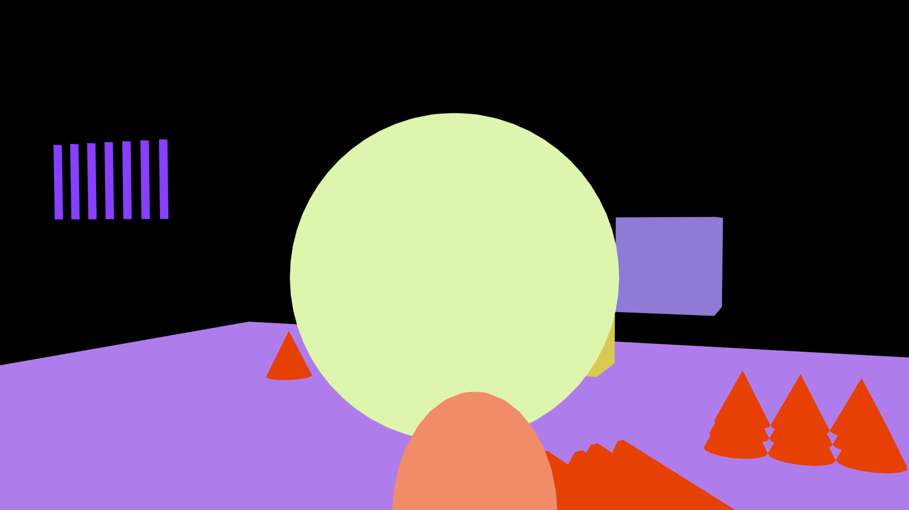
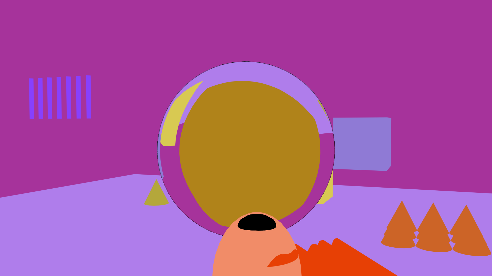
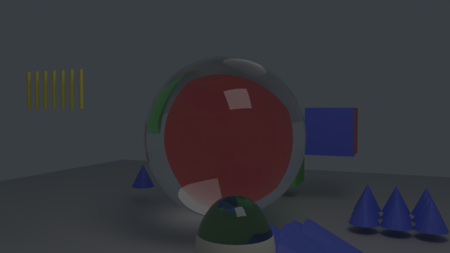
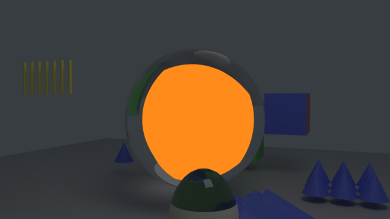
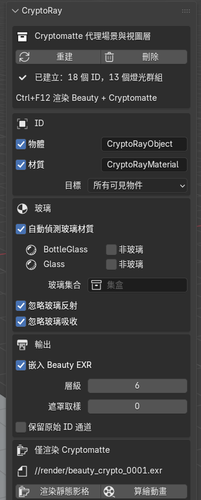
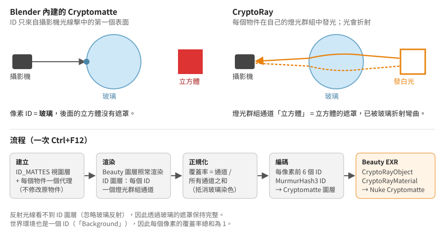

# CryptoRay for Blender

[English](README.md) · [简体中文](README.zh-CN.md) · **繁體中文**

為**透過折射玻璃看到的物件**產生 Cryptomatte ID 遮罩，折射變形與 Beauty 渲染完全一致。適用於
Blender 4.2 及以上版本的 Cycles，輸出標準的 Cryptomatte 圖層，Nuke 的 Cryptomatte 節點（或任何
Cryptomatte 讀取工具）可以直接拾取。

| Beauty | Blender 內建的 Cryptomatte | CryptoRay |
|---|---|---|
|  |  |  |
| 一個紅色立方體在玻璃球後面。 | 整個球是同一個 ID：「玻璃」。後面的東西都拾取不到。 | 玻璃後面的每個物件都保留自己的 ID，折射效果與 Beauty 相同。 |

拾取紅色立方體（`Cube_L`），以橙色顯示：

| Blender 內建的 Cryptomatte | CryptoRay |
|---|---|
|  |  |
| 空的：立方體完全在玻璃後面。 | 透過玻璃球看到的立方體。 |

---

## 安裝

1. 從 [Releases](https://github.com/adamykchan/cryptoRay_blender/releases) 下載 `cryptoray-<版本>.zip`
   （或自行把本儲存庫的 `cryptoray` 資料夾壓縮成 zip）。
2. 在 Blender 中：**編輯 › 偏好設定 › 附加元件 › ⌄ › 從磁碟安裝…**，選擇 zip，然後勾選 **CryptoRay**。
3. 在 3D 視圖中按 **N**，開啟 **CryptoRay** 分頁。

不需要安裝其他東西：EXR 處理使用 Blender 內建的 NumPy 和 OpenImageIO，因此可在 Windows、macOS 和
Linux 上執行。

## 快速上手

建議先用範例場景試試看：開啟 [`examples/cryptoray_test_scene.blend`](examples/cryptoray_test_scene.blend)
並另存到某個位置（渲染路徑是相對於 .blend 檔案的）。

**1. 建立。** 在「Cryptomatte 代理場景與視圖層」中點擊**建立**。面板會顯示產生了多少個 ID 和燈光群組。
建立之前，面板其餘部分是灰色的。之後如果新增了物件或變更了設定，面板會顯示「已過期」：點擊
**重建**即可。

**2. 選擇 ID。** 勾選**物體**和/或**材質**。旁邊的文字欄位是在 Nuke 中看到的 Cryptomatte 圖層名稱
（`CryptoRayObject`、`CryptoRayMaterial`）。**目標**保持「所有可見物件」，或選擇「集合」只為某個集合
產生 ID。

**3. 檢查玻璃。** 玻璃會被自動偵測：任何會折射的材質（玻璃 BSDF、折射 BSDF，或帶透射的原理化
BSDF）都會列在**自動偵測玻璃材質**下面。這些材質保持真實的玻璃效果，不分配 ID。如果其中某個需要
ID，勾選**非玻璃**。同時含有玻璃和其他材質的物件（例如貼了紙標籤的瓶子）會被拆分，標籤獲得 ID，
玻璃照樣折射。

**4. 設定輸出。** 渲染屬性 › 輸出：**OpenEXR 多層**，編碼 **ZIP** 或 **PIZ**（有損編碼會破壞 ID）。

**5. 渲染。** 按 **Ctrl+F12**（或用命令列 `blender -b file.blend -a`）。每渲染完一個影格，Cryptomatte
圖層就會寫入 Beauty EXR。Beauty 影像與不使用 CryptoRay 時完全一樣。

 

**只需要遮罩？** 在**僅渲染 Cryptomatte** 下點擊**渲染靜態影格**或**算繪動畫**。這只渲染 ID 圖層，並在
渲染檔案旁寫入 `<渲染名>_crypto_<影格>.exr`（目前影格的路徑顯示在按鈕上方）。不會渲染 Beauty，
渲染設定在完成後會恢復原樣。

> 普通的 **F12** 只顯示渲染結果，不儲存到磁碟，所以不會寫出 Cryptomatte 檔案。請使用 Ctrl+F12、
> 命令列，或「僅渲染 Cryptomatte」。

**用完了？** 點擊**刪除**會移除 CryptoRay 新增的所有內容。已渲染的檔案會保留。

## 在 Nuke 中使用

1. 用 Read 節點讀取 Beauty EXR。
2. 新增 **Cryptomatte** 節點，圖層選擇 **CryptoRayObject**（或 **CryptoRayMaterial**）。
3. 用滴管拾取物件，或在遮罩清單中輸入名稱。玻璃後面的物件可以隔著玻璃拾取。

不需要任何轉換步驟：EXR 中已經是帶清單（manifest）的標準 Cryptomatte 圖層。Blender 內建的
Cryptomatte 圖層（如果開啟）也會和 CryptoRay 的圖層一起保留在檔案裡。

## 選項

| 選項 | 預設 | 作用 |
|---|---|---|
| **物體 / 材質** | 物體 | 要寫出哪些 Cryptomatte 圖層。兩者來自同一次渲染。 |
| **目標** | 所有可見物件 | 「集合」：只有該集合中的物件獲得 ID，其他物件仍會遮擋後面的東西。 |
| **自動偵測玻璃材質** | 開 | 會折射的材質保持為玻璃。關閉：只由玻璃集合和 `matte_role` 決定哪些是玻璃。 |
| **非玻璃**（每個材質） | 關 | 仍為偵測到的玻璃材質分配 ID。 |
| **玻璃集合** | — | 此集合中的整個物件都視為玻璃。 |
| **忽略玻璃反射** | 開 | 玻璃上的反射不帶 ID，玻璃後的物件得到完整遮罩。關閉：被反射的物件會以部分覆蓋率出現在玻璃中。 |
| **忽略玻璃吸收** | 開 | 透過有色或吸光玻璃的遮罩保持完整強度。關閉：遮罩的強度等於實際透過的光。 |
| **嵌入 Beauty EXR** | 開 | 關閉：另外寫出 `<渲染名>_crypto_<影格>.exr`（RGBA 為彩色預覽）。 |
| **層級** | 6 | 每個像素儲存的 ID 數量（Cryptomatte 深度）。 |
| **遮罩取樣** | 0 | 僅用於 ID 圖層的取樣數。0 表示使用場景取樣數。玻璃很暗時可以調高。 |
| **保留原始 ID 通道** | 關 | 另外儲存原始燈光群組通道和 JSON 清單。每個通道都可以直接當遮罩使用。 |

逐一物件控制：可以在物件上加入自訂屬性 `matte_role`，值為 `"glass"`（視為玻璃）、`"ignore"`
（完全不進入 ID 圖層）或 `"other"`（會遮擋後面的物件，但自己沒有 ID）。

## 運作原理

**為什麼 Blender 內建的 Cryptomatte 做不到。** Cycles 只在攝影機光線第一次擊中表面的地方寫入
Cryptomatte ID。在玻璃後面，第一次擊中的就是玻璃，所以那裡的每個像素都是玻璃的 ID。著色器 AOV
也有同樣的限制，而附加元件無法修改 Cycles 核心。

**用光來傳遞 ID。** ID 無法穿過玻璃，但光可以。CryptoRay 新增第二個視圖層 `ID_MATTES`，其中每個
目標物件都發出純白光，並各自放在一個 Cycles **燈光群組**裡，而玻璃保持真實的著色器。燈光群組會把
渲染拆分成每組一個通道，所以每個通道正好就是一個物件的遮罩：已經被玻璃折射彎曲，被粗糙玻璃和
景深模糊，反鋸齒也與 Beauty 相同。

**不修改你的場景。** ID 圖層不會改動你的材質。它排除你所有的集合，使用自己的一組*代理*物件：每個
物件一個，用幾何節點的「物件資訊」節點即時讀取原物件，因此動畫、變形和修改器都會自動跟隨。代理物件
使用白色自發光材質；玻璃的代理保留原來的玻璃材質。粒子系統會產生一個種子相同的副本。所有新增內容
都帶有標記，因此**刪除**只會移除這些內容。無論有沒有 CryptoRay，Beauty 渲染都完全相同（已逐像素驗證）。

**把光轉換成覆蓋率。** 每渲染完一個影格，CryptoRay 讀取燈光群組通道，在每個像素上把每個通道除以
所有通道之和。世界環境也是一個 ID（`Background`），所以覆蓋率總和始終為 1，玻璃的染色和吸收也會
被抵消。反射光線看不到 ID 圖層，所以玻璃上的反射不會把其他 ID 混進遮罩。在攝影機幾乎只看到反射的
地方（例如瓶子邊緣的全內反射），玻璃後面沒有可顯示的東西，遮罩會以柔和的邊緣淡出。

**寫出 Cryptomatte。** 每個像素中最強的幾個 ID（預設 6 個）依照
[Cryptomatte 規範](https://github.com/Psyop/Cryptomatte)用 MurmurHash3 計算雜湊，並作為帶清單的標準
`CryptoRayObject00…` 圖層寫入 Beauty EXR。每個 ID 儲存真實的覆蓋率數值，而不是壓縮編碼，因此柔和的
邊緣也是正確的。

**物件 ID 與材質 ID 同時產生。** 每個「物件/材質」組合使用一個燈光群組。物件的遮罩是它所有組合之和；
材質的遮罩是所有物件中使用該材質的組合之和。因此兩個圖層來自同一次渲染。

## 中文介面

面板、工具提示和訊息都已翻譯成簡體中文和繁體中文。在**編輯 › 偏好設定 › 介面 › 翻譯**中選擇
*简体中文*或*繁體中文*，並勾選**介面**和**工具提示**。

## 限制

* 不支援**體積**，體積物件不進入 ID 圖層。
* **粒子**以被實例化的物件命名，與 Blender 內建的 Cryptomatte 相同。毛髮粒子已測試；發射器粒子會在
  副本中重新模擬，如果遮罩有偏差，請先烘焙。
* 集合實例和幾何節點實例使用**實例化物件本身**的名稱（Blender 內建的 Cryptomatte 會使用每個被實例化
  物件的名稱）。
* 每個燈光群組都是一個全解析度浮點緩衝區。超過 64 個時面板會警告；可以用「集合」目標減少數量。
* 直接放在*場景集合*中的物件無法在視圖層中排除。面板提供**移動根物件**，把它們放進一個集合
  （渲染結果不變）。
* Blender 內建的 Cryptomatte 清單中，大約每 128 個名稱有 1 個雜湊值有誤（像素本身正確）。CryptoRay
  遵循規範，因此每個名稱都能拾取。

## 範例場景

[`examples/cryptoray_test_scene.blend`](examples/cryptoray_test_scene.blend) 包含玻璃球後面的立方體、
貼有標籤的有色瓶子，以及實例化和粒子的測試案例，共 7 個影格（每個影格都有一個元素完全在玻璃球後面）。
同時開啟了 Blender 內建的 Cryptomatte 以便對比。
[`examples/make_test_scene.py`](examples/make_test_scene.py) 可以從零產生同一個場景：
`blender --python examples/make_test_scene.py`。

## 授權

Copyright © 2026 adamykchan。以 [GPL-3.0-or-later](LICENSE) 授權，與 Blender 相同。
