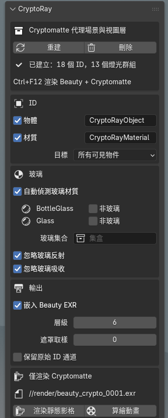
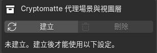
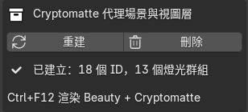
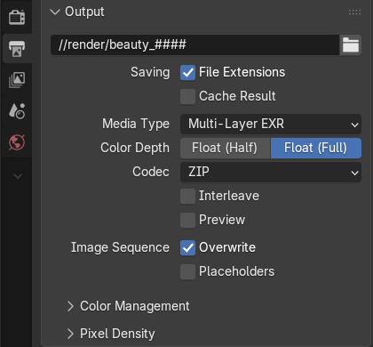
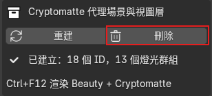
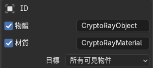
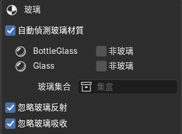
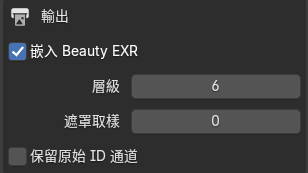
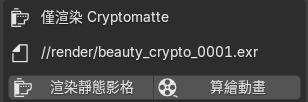

# CryptoRay for Blender

[English](README.md) · [简体中文](README.zh-CN.md) · **繁體中文**

為**透過折射玻璃看到的物件**產生 Cryptomatte ID 遮罩，折射變形與 Beauty 渲染完全一致。適用於 Blender 4.2 及以上版本的 Cycles，輸出標準的 Cryptomatte 圖層，Nuke 的 Cryptomatte 節點（或任何 Cryptomatte 讀取工具）可以直接拾取。

| Beauty | Blender 內建的 Cryptomatte | CryptoRay |
|---|---|---|
|  |  |  |
| 一個紅色立方體在玻璃球後面。 | 整個球是同一個 ID：「glass」。後面的東西都拾取不到。 | 玻璃後面的每個物件都保留自己的 ID，折射效果與 Beauty 相同。 |

拾取紅色立方體（`Cube_L`），以橙色顯示：

| Blender 內建的 Cryptomatte | CryptoRay |
|---|---|
|  |  |
| 空的：立方體完全在玻璃後面。 | 透過玻璃球看到的立方體。 |

## 安裝

1. 從 [Releases](https://github.com/adamykchan/cryptoRay_blender/releases) 下載 `cryptoray-<版本>.zip`。
2. 在 Blender 中：**編輯 › 偏好設定 › 附加元件 › ⌄ › 從磁碟安裝…**，選擇 zip，然後勾選 **CryptoRay**。
3. 在 3D 視圖中按 **N**，開啟 **CryptoRay** 分頁。

附加元件介面支援中文：在**編輯 › 偏好設定 › 介面 › 翻譯**中選擇*繁體中文*，並勾選**介面**和**工具提示**。

## 快速上手

### 1. 建立

點擊**建立**。

<table>
<tr><th>建立前</th><th>建立後</th></tr>
<tr><td></td>
<td></td></tr>
</table>

這會新增一個**代理場景**：一個名為 `ID_MATTES` 的額外視圖層，以及一個代理物件集合。CryptoRay 需要它來渲染遮罩。你自己的物件、材質和 Beauty 渲染都不會被改動。

之後如果新增了物件或變更了設定，面板會顯示「已過期」：點擊**重建**即可。

### 2. 像平常一樣渲染動畫

輸出格式必須是 **OpenEXR 多層**（Blender 5 中為 *Multi-Layer EXR*），編碼為 **ZIP** 或 **PIZ**。

按 **Ctrl+F12**（*渲染 › 算繪動畫*），或用命令列渲染。

現在每個影格的 EXR 都包含 Cryptomatte 圖層 `CryptoRayObject`（勾選了材質時還有 `CryptoRayMaterial`）。在 Nuke 中讀取 EXR，新增 **Cryptomatte** 節點，選擇該圖層並拾取物件，包括玻璃後面的物件。

**F12**（渲染影像）只顯示渲染結果，不儲存到磁碟，所以不會產生 Cryptomatte。

### 3. 刪除

用完後點擊**刪除**。它會移除 CryptoRay 新增的所有內容。已渲染的檔案會保留。

## 設定

### ID

* **物體：**寫出一個 Cryptomatte 圖層，每個物件一個 ID，命名方式與 Blender 內建的 CryptoObject 相同。
* **材質：**寫出一個圖層，每個材質一個 ID，命名方式與 Blender 內建的 CryptoMaterial 相同。
* 旁邊的文字欄位是你在 Nuke 中看到的**圖層名稱**。預設為 `CryptoRayObject` 和 `CryptoRayMaterial`。
* **目標：**
  * *所有可見物件：*除玻璃外，每個可見物件都獲得 ID。
  * *集合：*只有所選集合中的物件獲得 ID。其他物件仍會遮擋後面的東西。大型場景中可以用它減少燈光群組數量。

### 玻璃

* **自動偵測玻璃材質：**依材質找出玻璃。任何會折射的材質（玻璃 BSDF、折射 BSDF，或帶透射的原理化 BSDF）都會列在這裡。玻璃保留真實的著色器，因此會彎曲遮罩，它自己不獲得 ID。同時含有玻璃和其他材質的物件（例如貼了紙標籤的瓶子）會被拆分：標籤獲得 ID，玻璃照樣折射。
* **非玻璃：**勾選後，該材質被當作一般表面而不是玻璃。它會在 Cryptomatte 中獲得自己的 ID，遮罩也不再顯示它後面的東西。
* **玻璃集合：**可選。此集合中的整個物件都視為玻璃。
* **忽略玻璃反射**（預設開啟）：玻璃上的反射不帶 ID，所以玻璃後面的東西得到完整的遮罩。關閉後，被反射的物件也會出現在玻璃中，混進遮罩裡。

<table>
<tr><th>渲染</th><th>開啟（預設）</th><th>關閉</th></tr>
<tr><td></td>
<td></td>
<td></td></tr>
<tr><td>Beauty：地面和立方體倒映在球上。</td>
<td>只有玻璃後面的東西。</td>
<td>反射也帶有 ID：地面（黃色）填滿了球的上半部，被反射的物件混進玻璃後面的東西裡。</td></tr>
</table>

*忽略玻璃反射：範例場景第 2 影格，每種顏色代表一個 ID。*

* **忽略玻璃吸收**（預設開啟）：有色或吸光的玻璃不會削弱遮罩。關閉後，遮罩的強度只等於實際透過玻璃的光。

<table>
<tr><th>渲染</th><th>開啟（預設）</th><th>關閉</th></tr>
<tr><td></td>
<td></td>
<td></td></tr>
<tr><td>Beauty：紅色立方體一半在藍色玻璃球後面。</td>
<td>立方體在玻璃外和透過玻璃的顏色相同：完整強度。</td>
<td>透過玻璃的立方體較暗：強度只等於透過來的光。</td></tr>
</table>

*忽略玻璃吸收：第 1 影格，玻璃染成藍色，每種顏色代表一個 ID，紅色立方體以黃色顯示為已拾取。*

也可以逐一為物件加入自訂屬性 `matte_role`：`"glass"`（視為玻璃）、`"ignore"`（完全排除）或 `"other"`（遮擋後面的東西，但自己沒有 ID）。

*物件屬性 › 自訂屬性：點擊「新增」，命名為 `matte_role`，類型設為字串，值為 `glass`、`ignore` 或 `other`。*

### 輸出

* **嵌入 Beauty EXR**（預設開啟）：Cryptomatte 圖層寫入 Beauty EXR。關閉：寫到旁邊獨立的 `<渲染名>_crypto_<影格>.exr`。
* **層級：**每個像素儲存的 ID 數量（Cryptomatte 深度）。通常為 6。
* **遮罩取樣：**僅用於遮罩渲染的取樣數。0 表示使用場景的取樣數。玻璃很暗導致遮罩有雜訊時可以調高。
* **保留原始 ID 通道：**另外儲存原始燈光群組通道和 JSON 清單。每個通道都可以直接當遮罩使用。

### 僅渲染 Cryptomatte

只渲染遮罩，不渲染 Beauty，並將 `<渲染名>_crypto_<影格>.exr` 寫到顯示的路徑。適合只需要重新渲染遮罩，或者 Beauty 輸出不是多層 EXR 的情況。**渲染靜態影格**渲染目前影格，**算繪動畫**渲染影格範圍。它會先詢問是否重新建立代理場景（預設為是）。完成後渲染設定會恢復原樣。

## 運作原理

**問題所在。** Cycles 只在攝影機光線第一次擊中表面的地方寫入 Cryptomatte ID。在玻璃後面，這個表面就是玻璃，所以那裡的每個像素都是玻璃的 ID（見頂部的對比）。著色器 AOV 也有同樣的限制，而附加元件無法修改 Cycles 本身。

**用光來傳遞 ID。** ID 無法穿過玻璃，但光可以。所以 CryptoRay 在自己的視圖層中再渲染一次：每個物件都發出純白光，玻璃保持真實材質。每個物件放在自己的 Cycles **燈光群組**裡，Cycles 會把每個燈光群組單獨儲存為一張影像。這張影像就是該物件的遮罩：已經被玻璃折射，被粗糙玻璃和景深模糊，反鋸齒也與 Beauty 完全相同。

**不改動你的場景。** 把材質改成白色會改變 Beauty 渲染。所以 `ID_MATTES` 視圖層隱藏你所有的集合，改為顯示它自己的副本：每個物件一個代理，用幾何節點的*物件資訊*節點製作，因此會自動跟隨原物件的動畫、變形和修改器。代理使用白色發光材質；玻璃的代理保留原來的玻璃材質。這就是**建立**新增、**刪除**移除的代理場景。無論有沒有它，Beauty 渲染都完全相同（已逐像素驗證），而且兩個圖層在同一次 Ctrl+F12 中一起渲染。

**粒子的處理方式不同。** 物件資訊節點無法讀取舊式粒子系統，所以 CryptoRay 會為每個粒子系統新增一個發射體副本，種子和設定都相同，因此粒子完全一樣。副本的粒子實例化的是發白光的物件副本，而不是原物件，所以每個粒子都獲得它所實例化物件的 ID（與 Blender 內建的 Cryptomatte 相同）。以髮絲渲染的毛髮會在副本上使用白色材質，其 ID 來自發射體的髮絲材質。發射體粒子會在副本中重新模擬，如果遮罩有偏差，請先烘焙。

**從光到覆蓋率。** 每渲染完一個影格，CryptoRay 讀取各燈光群組，在每個像素上把每個燈光群組除以所有燈光群組之和，得到每個物件在該像素中所佔的比例。世界環境也是一個 ID（`Background`），所以比例總和始終為 1。除以總和也會抵消玻璃的染色和吸收（**忽略玻璃吸收**）。反射光線看不到發光的代理（**忽略玻璃反射**），所以反射不會把其他 ID 混進來。在攝影機幾乎只看到反射的地方（例如瓶子邊緣的全內反射），玻璃後面沒有可顯示的東西，遮罩會柔和地淡出。

**寫出 Cryptomatte。** 每個像素中最強的幾個 ID（預設 6 個）連同覆蓋率一起儲存，名稱依照 [Cryptomatte 規範](https://github.com/Psyop/Cryptomatte)的要求計算雜湊，結果作為帶清單的標準 Cryptomatte 圖層寫入 EXR。之後原始燈光群組會從檔案中移除。

**物件與材質同時產生。** 每個「物件/材質」組合使用一個燈光群組。物件的遮罩是它所有組合之和，材質的遮罩是所有物件中該材質的組合之和，因此兩個圖層來自同一次渲染。

## 限制

* 不支援**體積**，體積不會進入遮罩。
* **粒子**以被實例化的物件命名，與 Blender 內建的 Cryptomatte 相同。毛髮粒子已測試；發射體粒子會在代理中重新模擬，如果遮罩有偏差，請先烘焙。
* 集合實例和幾何節點實例使用**實例化物件本身**的名稱（Blender 內建的 Cryptomatte 使用每個被實例化物件的名稱）。
* 每個燈光群組都是顯示記憶體中一張全解析度影像。超過 64 個時面板會警告；可以用「集合」目標減少數量。
* 直接放在*場景集合*中（不在任何集合裡）的物件無法從 ID 圖層中隱藏，所以建立會停止，並提供**移動根物件**，把它們放進一個新集合。你的渲染結果不變。
* Blender 內建的 Cryptomatte 清單中，大約每 128 個名稱有 1 個雜湊值有誤（像素本身正確）。CryptoRay 遵循規範，因此每個名稱都能拾取。

## 範例場景

[`examples/cryptoray_test_scene.blend`](examples/cryptoray_test_scene.blend) 包含玻璃球後面的立方體、貼有標籤的有色瓶子，以及實例化和粒子的測試案例，共 7 個影格（每個影格都有一個元素完全在玻璃球後面）。同時開啟了 Blender 內建的 Cryptomatte 以便對比。渲染前請先另存到某個位置（輸出路徑是相對於 .blend 檔案的）。[`examples/make_test_scene.py`](examples/make_test_scene.py) 可以從零產生同一個場景：`blender --python examples/make_test_scene.py`。

## 授權

Copyright © 2026 adamykchan。以 [GPL-3.0-or-later](LICENSE) 授權。
